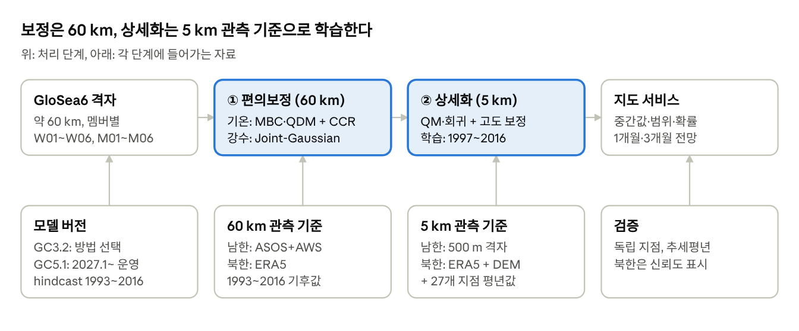

# 한반도 5 km 객관기후예측 자료·처리 계획

2026-11-03 · solver

원본(편집본): [Claude 문서](https://claude.ai/artifact/54q4xcemirGysf9ov6FngW). 이 파일은 그 시점의 사본입니다.

## 요약

북한을 포함한 한반도 전체에 **5 km 격자**로 1개월(1~4주)·3개월(M+1~M+3) 기온·강수 전망을 서비스합니다. 처리는 **60 km에서 편의보정 → 5 km로 상세화**의 두 단계입니다. 관측 기준은 남한은 기상청 500 m 격자자료와 ASOS+AWS, 북한은 ERA5와 DEM입니다.

확정된 결정 (solver, 2026-11-03):

- 서비스 격자는 한반도 전체 5 km. 북한은 우선 ERA5 + DEM으로 처리
- GloSea6는 한반도 영역만 잘라, 일자료 대신 멤버별 주·월 집계로 받음
- hindcast는 1993~2016(24년). 개발은 GC3.2, 2027년 1월부터 운영은 GC5.1
- 남한 관측: 500 m 격자(1997~), ASOS+AWS 약 700개 지점 일자료. 북한 관측: 27개 지점(1973~)과 평년값. 모두 기상청 API허브

가장 큰 미확인 사항은 **GloSea6 격자 hindcast(특히 GC5.1)의 존재와 사양**입니다. 이것이 없으면 격자별 보정을 할 수 없습니다.

## 1. 서비스 정의

| 항목 | 1개월 전망 | 3개월 전망 |
| --- | --- | --- |
| 서비스 시작 목표 | 2027년 5월 | 2027년 11월 |
| 사용 초기화 | 매주 월요일 | 매월 중순(12~18일 월요일) |
| 서비스 기간 → 모델 리드 | 1~4주 → W03~W06 (W01은 초기화 주, W01~W02는 중기예보 구간) | M+1~M+3 → M01~M03 |
| 집계 단위 | 주(월~일) | 달력 월 |
| 변수 | 평균·최고·최저기온, 강수량 | 상동 |
| 산출물 | 중간값, 예측 범위(10~90%), 3분위 확률, 평년 대비 편차 | 상동 |
| 격자·영역 | 한반도 전체 육상 5 km (약 9천 격자) | 상동 |

지도의 "평년 대비" 표출은 1991~2020 평년을 쓰고, 보정 계산은 hindcast와 같은 1993~2016 기후값을 씁니다. 북한은 관측으로 검증되지 않은 세부가 많아 지도에 신뢰도 차이를 표시합니다.

## 2. 처리 흐름

편의보정은 GloSea6 원 격자(약 60 km)에서 관측을 같은 크기로 묶은 기준으로 하고, 상세화는 5 km 관측 기준으로 학습합니다. 그래서 관측 기준이 두 해상도로 필요합니다.

## 3. 모델 자료 (GloSea6)

GC3.2와 GC5.1 모두 같은 규격으로 hindcast와 실시간을 받습니다. 같은 코드가 입력 파일만 바꿔 두 버전을 처리하게 하려는 것입니다. 전체 크기는 버전당 약 1 GB 이하로 추정됩니다.

| 항목 | 요청 사양 | 이유 |
| --- | --- | --- |
| 버전 | GC3.2(개발·방법 선택), GC5.1(2027년 1월~ 운영) | 7절 전환 대책 |
| hindcast 연도 | 1993~2016 24년 전부 | 교차검증 표본 |
| 초기화일 | 1년 내 모든 주간 초기화(월요일 대응일) | 1개월은 매주, 3개월은 중순 초기화. D·D-7·D-14·D-21을 묶은 의사 지연 앙상블도 만듦 |
| 멤버 | 초기화별 전 멤버(GC3.2는 7개), 멤버 번호 포함, 평균하지 않음 | 범위·확률에 퍼짐이 필요 |
| 리드·집계 | 주 W01~W06(월~일), 월 M01~M06(달력 월). 일자료는 불필요 | 리드 정의가 바뀌어도 재요청 불필요 |
| 변수 | 일평균·일최고·일최저기온의 구간 평균(°C), 강수 합계(mm) | 서비스 변수 |
| 영역 | 약 31~45°N, 122~134°E, 원 격자 그대로 | 제주·울릉도·독도 포함, 가장자리 2~3격자 여유 |
| 부가 자료 | 같은 영역의 모델 지형고도, 해륙 마스크, 위경도 | 고도 보정, 해안 처리 |
| 시간 정의 | 일 경계(KST/UTC), 주 시작일, 강수 누적 구간을 메타자료에 명시 | 관측 집계와 구간 일치 |
| 실시간 | GC3.2 2023~2026, GC5.1 2026~. 운영과 같은 지연 멤버 구성 | 최종 확인·운영 입력 |
| 형식 | NetCDF(CF), 차원 (초기화, 멤버, 리드, 위도, 경도) | 읽기·검수 편의 |

받은 뒤에는 격자에서 62개 지점 평균을 다시 계산해 기존 패키지 값과 맞는지부터 확인합니다. 폭염일수 같은 극한 지수를 나중에 서비스하려면 그 지수도 미리 계산해 받아야 합니다. Z500 등 대규모 예측인자는 강수 개선을 시도할 때 동아시아 영역으로 따로 받습니다.

## 4. 관측·기준 자료

남한은 기상청 자료만으로 BoM·DWD 수준의 관측 기준을 만들 수 있습니다. 북한은 27개 지점뿐이라 ERA5 + DEM이 바탕이고, 지점은 평균 확인에 씁니다. 아래 API는 모두 기상청 API허브(apihub.kma.go.kr)입니다.

| 자료 | 범위·기간 | 용도 | 상태 |
| --- | --- | --- | --- |
| 고해상도 격자자료 (nph-sfc_obs_nc_api) | 남한 500 m, 1997~, 5분 간격, 기온(ta)·일강수(rn_day) 등 | 남한 5 km 관측 기준, 5 km 기후값, 상세화 학습, 격자 검증 | 확보 경로 확인 |
| 기후통계 (sts_ta, sts_rn) | ASOS+AWS 약 700개 지점, 1904~, 일·월·연, 일최고·최저 포함 | 60 km 보정 기준, 격자 최고·최저 보정, 1993~1996 채움, 독립 검증 | 확보 경로 확인 |
| 북한 지상관측 (nko_sfctm) | 27개 지점, 1973~(지점별 상이), 시간 자료, 1회 48시간 | 북한 ERA5 편의 확인, 북한 검증 | 확보 경로 확인, 결측률 미확인 |
| 북한 평년값 (sfc_nko_norm1) | 27개 지점, 일·순·월·연, 1991~2020 등 | 북한 5 km 기후값 기준점 | 확보 경로 확인 |
| ERA5 | 0.25°(약 25~31 km), 1940~, 약 5일 지연 | 북한의 주·월 편차, 남북 연속성 | 공개(Copernicus CDS) |
| ERA5-Land | 0.1°(약 9 km), 1950~ | ERA5보다 세밀한 북한 기온 보조 | 공개, 선택 |
| MSWEP 또는 CHIRPS | 강수 0.1°/0.05°, 1979~/1981~ | 북한 강수 비교용 (ERA5 강수의 약한 비 과다·호우 과소 보완) | 공개, 선택 |

남한 관측 기준 만드는 법:

1. 500 m 격자를 5 km로 평균하고 주(월~일)·월로 집계합니다. 받으면서 바로 5 km로 줄여 저장합니다.
2. 최고·최저기온은 매시 ta의 최댓값·최솟값에 지점 TMX_DD·TMN_DD와의 차이를 보정합니다.
3. 1993~1996은 지점 자료와 ERA5 편차로 채웁니다.
4. 일평균 정의(지점 TA_DAVG는 8회 정시 평균, 격자는 매시 평균)를 하나로 맞춥니다.
5. 관측망 밀도 변화에 따른 가짜 추세는 ASOS 장기 지점으로 점검합니다.

북한 관측 기준 만드는 법: ERA5를 5 km로 보간하고 기온은 DEM 고도 보정을 더합니다. 고도 보정 관계는 남한 500 m 격자에서 학습합니다. 평균은 27개 지점 평년값으로 맞추고, 강수는 평년 비율로 보정합니다. 휴전선 부근에는 완충 띠를 두어 남북 값이 끊기지 않게 잇습니다. 남한에서 같은 ERA5 + DEM 방식을 500 m 격자와 비교하면 북한 지도의 오차를 수치로 제시할 수 있습니다.

수집 스크립트: [scripts/40_fetch_nk.py](scripts/40_fetch_nk.py)(북한), [scripts/41_fetch_sts.py](scripts/41_fetch_sts.py)(ASOS+AWS). 아직 실행하지 못했습니다(클라우드 환경에서 apihub 접속 차단). 인증키는 환경변수 `KMA_AUTH`로 넘깁니다. 500 m 격자는 API로 매시 기온만 약 26만 번 호출이라, 기상청 내부에서 일 단위 또는 5 km 집계 파일로 받는 편이 낫습니다.

## 5. 지형·보조 자료

모두 공개 자료라 확보 부담은 작습니다. 먼저 5 km 서비스 격자를 확정해야 모든 자료를 같은 격자에 맞출 수 있습니다.

| 항목 | 용도 | 출처 후보 |
| --- | --- | --- |
| 5 km 서비스 격자 정의 | 모든 자료의 공통 기준 | 기상청 단기예보 5 km 격자와 맞출지 결정 필요 |
| DEM | 기온 고도 보정(특히 북한), 상세화 예측인자 | Copernicus GLO-30/90, SRTM, GMTED2010 |
| 지형 파생변수 (경사·사면방향·골짜기 지수, 해안 거리) | 최저기온·강수 상세화 예측인자 | DEM에서 계산 |
| 해안선·육지 마스크 | 육상 격자만 서비스 | GSHHG, Natural Earth, 국토지리정보원 |
| 행정경계 (남한 시·도, 북한 도) | 지도 표출, 권역 평균 | 국토지리정보원, 기상청 서비스 지도 규정 |
| 토지피복·도시 비율 | 도시 열섬 등 지점·격자 차이 설명 (개선 단계) | ESA WorldCover, 환경부 토지피복도 |

## 6. 처리 방법

편의보정은 성격이 다른 두 갈래에서 하나씩 골라 섞고, 상세화는 BoM 방식(QM·회귀 + 고도 보정)으로 시작합니다. 모든 순위는 62개 지점 평균 시험 기준이므로, 격자 hindcast가 오면 같은 교차검증으로 다시 확인합니다.

### 6-1. 편의보정 (60 km)

| 갈래 | 방법 | 특징 | 판단 |
| --- | --- | --- | --- |
| ① 모델을 믿는 방법 | MBC | 모든 멤버를 hindcast 평균 편의만큼 옮김(강수는 비율). 멤버 퍼짐은 그대로 | 기온 후보. 실시간 시험에서 강함 |
| | QM | 분포 전체를 분위수끼리 짝지음. 24년×7멤버로는 꼬리가 흔들림 | 보정보다 상세화 단계에 사용 |
| | QDM, DQM | 추세를 다루는 QM 변형. hindcast 중심이 2004년이라 의미 있음 | 기온 후보(MBC 대안) |
| | LPM | 효과는 경로 A(모델 기후 기준 확률)에서만 나왔고 MBC·QM과 사실상 같음. 경로 B(최근 오차)는 세 시험 모두 점수 하락 | 비교 후보로만 |
| ② 맞힌 만큼만 믿는 방법 | CCR | 중심값 = 평년 + ρ × 모델 편차(변동폭 비 환산), 범위 = 기후 범위 × √(1−ρ²). ρ가 0이면 평년 + 기후 범위 | 기온 후보(추세 반영형). hindcast 시험에서 강함 |
| | Joint-Gaussian (BJP 계열) | 모델·관측을 함께 정규분포로 보는 일반형. 변환으로 강수를 다루고 매개변수 불확실성 반영 | 강수 중심 후보 |

추천 조합: 기온은 ①의 MBC 또는 QDM과 ②의 추세 반영 CCR을 3분위 확률 기준 반씩 평균합니다. 재검토에서 CCR+MBC 평균은 어느 시험에서도 크게 지지 않았습니다. 강수는 Joint-Gaussian(변환 포함)을 중심으로 ①과 비교합니다. hindcast 중심연도(약 2004년)와 현재의 기후 차이는 추세평년으로 따로 반영합니다.

### 6-2. 상세화 (60 km → 5 km)

- **QM**: 보정된 예측이 모델 기후에서 몇 번째 백분위인지 보고, 5 km 관측 기후의 같은 백분위 값으로 바꿉니다. BoM은 이 QQ로 보정과 상세화를 한 번에 합니다.
- **회귀**: 5 km 편차 = a + b × 60 km 보정 편차 + 잔차이고, 5 km 기후값을 더합니다. 62개 지점 시험에서 기온 기술의 87~93%를 유지했습니다.
- 학습은 남한 500 m 격자(1997~2016)로 합니다. 두 단계(보정 후 상세화)와 BoM식 한 단계를 격자 hindcast로 비교해 고릅니다.
- 상세화는 공간 세부를 더할 뿐 예측 기술을 높이지 않습니다. 최종 품질에는 hindcast 길이와 멤버 수가 더 크게 작용합니다.

### 6-3. 북한

북한은 학습할 격자 관측이 없으므로, 남한에서 배운 고도·해안 관계와 ERA5 + DEM 기후값으로 상세화합니다. 27개 지점 평년값으로 평균을 확인하고, 지도에는 신뢰도 차이를 표시합니다.

### 6-4. 연구 과제 (2027년 이후)

- **DWD EPISODES**: 대규모 장으로 유사일을 찾고 회귀하는 방식입니다. GloSea6 대규모 장 일자료가 필요해 1단계 요청(주·월 집계)과 맞지 않습니다.
- **CorrDiff**: 상세화 방법이지 편의보정이 아닙니다. ERA5→고해상도 관계는 배우지만 GloSea6의 리드별 드리프트는 모릅니다. 쓴다면 통계 보정 뒤에 둔 뒤 관측으로 다시 확인합니다. 북한 지형 세부 표현에 장점이 있습니다.

## 7. GC3.2 → GC5.1 전환 대책

개발은 GC3.2로 하지만 2027년 1월부터 GC5.1을 써야 하고, GC5.1 실시간은 2026년 1년뿐입니다. 대책은 **방법은 GC3.2로 고르고, 매개변수는 GC5.1 hindcast로 다시 맞추며, 2026년 실시간은 검수에만 쓰는 것**입니다. 이 대책은 GC5.1에 hindcast가 있다는 전제에 달려 있습니다.

| 대책 | 내용 |
| --- | --- |
| 역할 분리 | GC3.2(hindcast 24년 + 2023~26 실시간)는 방법 선택과 코드 개발에 씁니다. 편의·회귀계수·분위수는 GC5.1 hindcast로 다시 추정합니다. |
| 자동 추정 | 모든 매개변수를 hindcast에서 자동으로 구하게 만들어, 모델을 바꿔도 입력 파일만 바꾸면 되게 합니다. |
| 단순한 방법 우선 | 검증 기회가 적으므로 매개변수가 적은 방법을 고릅니다. MBC는 편의 1개, CCR은 평년·상관·변동폭 비 3개 정도입니다. |
| 검증은 hindcast 교차검증이 주 | 2026년은 1개월 52회, 3개월 12회뿐이라 기술 추정에 부족합니다. hindcast와 실시간의 편의·퍼짐이 맞는지 검수하는 데 씁니다. |
| 두 버전 비교 | 같은 hindcast 연도에서 GC3.2와 GC5.1의 편의·기술을 격자별로 비교해, 다른 항목만 다시 선택합니다. |
| 안전장치 | GC5.1 hindcast에서 기술이 확인되지 않은 격자·리드·변수는 추세평년 + 기후 범위로 표출합니다. |
| 운영 중 갱신 | 2027년부터 쌓이는 GC5.1 실시간을 해마다 학습·검증에 더하고, 편의를 분기마다 감시합니다. |

## 8. 검증·운영

검증은 재검토의 세 시험장(hindcast 교차검증, 의사 지연 hindcast, 실시간)을 5 km 격자로 옮기고, 기준 예측은 추세평년입니다.

| 항목 | 내용 |
| --- | --- |
| 점수 | RPSS(3분위), CRPSS, 80% 범위 포함률, 신뢰도 도표. 격자별 지도로 표출 |
| 독립 검증 | 상세화 학습에서 뺀 ASOS·AWS 지점, 북한 27개 지점 |
| 북한 오차 추정 | 남한에서 ERA5 + DEM 방식과 500 m 격자를 비교한 오차를 북한 신뢰도로 사용 |
| 실시간 일정 | 1개월: 월요일 초기화 자료가 목요일 발표 전 도착. 3개월: 중순 초기화 자료가 매월 23일경 발표 전 도착 (미확인) |
| 운영 감시 | 직전 주·월 관측(500 m 격자, ASOS+AWS, 북한 GTS, ERA5T)으로 사후 검증, 분기별 편의 점검 |
| 저장 | 매개변수(격자·리드·시기별), 발표별 결과 NetCDF(중간값, 10·90%, 3분위 확률) + 지도 이미지 |

## 9. 할 일과 기상청 확인 요청

기상청에 확인할 것 (위에서부터 급한 순서):

- [ ] GC5.1 hindcast의 존재, 기간, 초기화 빈도, 멤버 수, 원 격자 해상도
- [ ] GC3.2·GC5.1 격자 hindcast와 실시간을 3절 사양(한반도, 멤버별 주·월 집계)으로 받을 수 있는 시점
- [ ] 2026년 GC5.1과 GC3.2 병행 운영 여부, 실시간 멤버 구성과 도착 시각
- [ ] 500 m 격자자료를 일 단위 또는 5 km 집계 파일로 받을 수 있는지
- [ ] 서비스 격자를 단기예보 5 km 격자에 맞출지

우리 쪽 할 일:

1. **자료 수집**: ASOS+AWS 일자료, 북한 지점·평년값, ERA5, DEM. 클라우드 환경에서 쓰려면 프로젝트 설정의 허용 도메인에 apihub.kma.go.kr(과 ERA5용 cds.climate.copernicus.eu) 추가가 필요합니다.
2. **관측 기준 격자**: 남한 5 km(500 m 평균 + 지점 보정), 북한 5 km(ERA5 + DEM + 평년값), 경계 접합, 남한에서 북한 방식 오차 추정
3. **격자 hindcast 검수**: 62개 지점 평균 재현으로 리드 정의 확인
4. **방법 선택**: GC3.2로 6절 후보를 5 km 격자에서 교차검증
5. **GC5.1 재학습**: 같은 코드로 매개변수 재추정, 2026년 실시간 검수
6. **지도 산출물**: 중간값·범위·확률 지도와 신뢰도 표시 방식

이전 문서: [전략](https://claude.ai/artifact/1YrMY5pTLGR2EnnuiJq9aP), [원점 재검토](https://claude.ai/artifact/Xjqcjbo7hnBcKvd2tEL63b), [필요 자료 초안](https://claude.ai/artifact/P2ADDVe32L1dy2JMZockgh).
