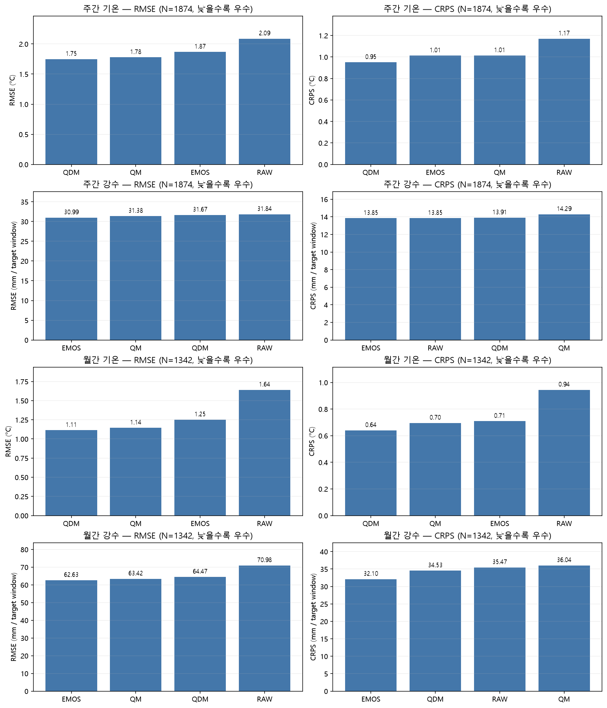
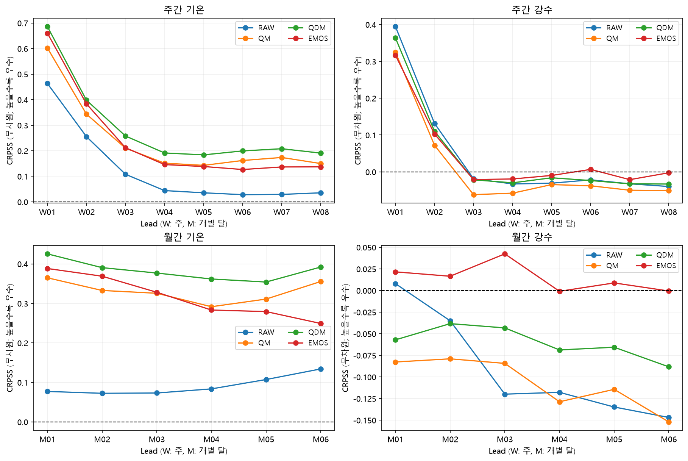
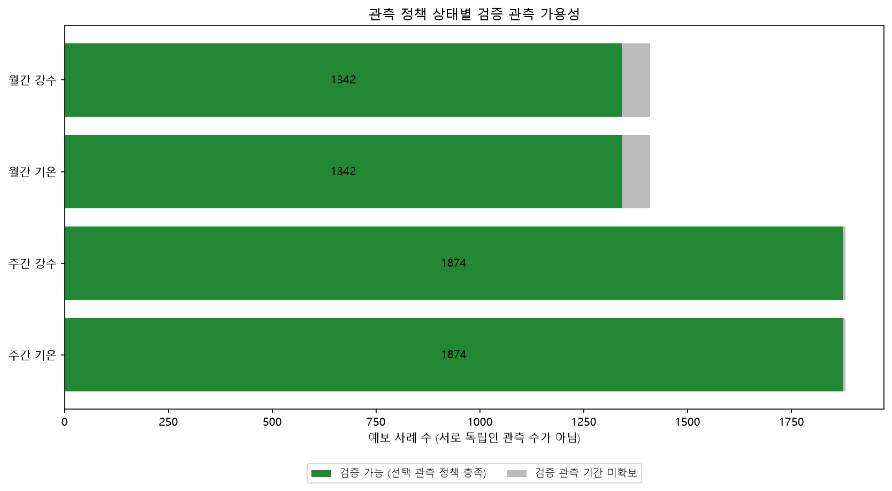

# GLOSEA6 실제 예보 검증 보고서

완료 상태: **PASS**, 전체 6,580개 중 검증 6,432개, 각 방법 6,432행. EMOS 적합 실패 0건; 파이프라인 실행 92.99초.

## 1. 자료와 선택 편향: 결과 해석 전에 확인

관측: 1991-01-01–2026-10-05; 예보 초기일: 2022-03-07–2026-08-31.

지점 목록 62개; 실제 일별 기여: 기온 60지점 17일 / 61지점 248일 / 62지점 12,797일; 강수 61지점 24일 / 62지점 13,038일.

관측 출처: nalssi89/kmahub 정책의 KMA API Hub; 수집 완료 UTC: 2026-10-06T23:42:09.597Z

수집 범위: 19910101–20261005; 지점·날짜 행 809820 / 기대 809844

최신 완결 관측일: 20261005; 이후 모델 검증 구간은 관측 미확보로 제외한다.

원 지점·날짜 행 누락 24행; 기온 측정 무효 258행 / 강수 측정 무효 0행 (수집 행 내 변수별 측정 무효; 행 누락과 별개).

지점 행 존재 분포: 61지점 24일 / 62지점 13,038일

QC는 측정값 유효성·변수별 기여 수에서 파생한 검사이며 KMA 원래 기기 QC가 아니다.

### 지점별 수집 행·측정값 감사

기록된 station_daily_sha256와 일치하는 원자료의 유효성 플래그를 직접 센다. 아래 행 누락 수는 지점×요청 일수 기준이며 기기 QC 판정이 아니다.

| STN | 수집 행 | 행 누락 | 유효 기온 | 기온 무효 | 유효 강수 | 강수 무효 |
| --- | --- | --- | --- | --- | --- | --- |
| 90 | 13062 | 0 | 13058 | 4 | 13062 | 0 |
| 95 | 13062 | 0 | 13061 | 1 | 13062 | 0 |
| 100 | 13062 | 0 | 13055 | 7 | 13062 | 0 |
| 101 | 13062 | 0 | 13055 | 7 | 13062 | 0 |
| 105 | 13062 | 0 | 13061 | 1 | 13062 | 0 |
| 108 | 13062 | 0 | 13062 | 0 | 13062 | 0 |
| 112 | 13062 | 0 | 13061 | 1 | 13062 | 0 |
| 114 | 13062 | 0 | 13061 | 1 | 13062 | 0 |
| 119 | 13062 | 0 | 13062 | 0 | 13062 | 0 |
| 127 | 13062 | 0 | 13057 | 5 | 13062 | 0 |
| 129 | 13062 | 0 | 13053 | 9 | 13062 | 0 |
| 130 | 13062 | 0 | 13056 | 6 | 13062 | 0 |
| 131 | 13062 | 0 | 13061 | 1 | 13062 | 0 |
| 133 | 13062 | 0 | 13062 | 0 | 13062 | 0 |
| 135 | 13062 | 0 | 13061 | 1 | 13062 | 0 |
| 136 | 13062 | 0 | 13062 | 0 | 13062 | 0 |
| 138 | 13062 | 0 | 13059 | 3 | 13062 | 0 |
| 140 | 13062 | 0 | 13048 | 14 | 13062 | 0 |
| 143 | 13062 | 0 | 13061 | 1 | 13062 | 0 |
| 146 | 13062 | 0 | 13062 | 0 | 13062 | 0 |
| 152 | 13062 | 0 | 13062 | 0 | 13062 | 0 |
| 155 | 13062 | 0 | 13062 | 0 | 13062 | 0 |
| 156 | 13062 | 0 | 13062 | 0 | 13062 | 0 |
| 159 | 13062 | 0 | 13062 | 0 | 13062 | 0 |
| 162 | 13062 | 0 | 13056 | 6 | 13062 | 0 |
| 165 | 13062 | 0 | 13061 | 1 | 13062 | 0 |
| 168 | 13062 | 0 | 13060 | 2 | 13062 | 0 |
| 170 | 13060 | 2 | 13038 | 22 | 13060 | 0 |
| 192 | 13061 | 1 | 13056 | 5 | 13061 | 0 |
| 201 | 13062 | 0 | 13055 | 7 | 13062 | 0 |
| 202 | 13058 | 4 | 13048 | 10 | 13058 | 0 |
| 203 | 13062 | 0 | 13056 | 6 | 13062 | 0 |
| 211 | 13061 | 1 | 13059 | 2 | 13061 | 0 |
| 212 | 13058 | 4 | 13055 | 3 | 13058 | 0 |
| 216 | 13062 | 0 | 13060 | 2 | 13062 | 0 |
| 221 | 13062 | 0 | 13057 | 5 | 13062 | 0 |
| 226 | 13062 | 0 | 13060 | 2 | 13062 | 0 |
| 232 | 13062 | 0 | 13058 | 4 | 13062 | 0 |
| 235 | 13062 | 0 | 13061 | 1 | 13062 | 0 |
| 236 | 13062 | 0 | 13057 | 5 | 13062 | 0 |
| 238 | 13062 | 0 | 13059 | 3 | 13062 | 0 |
| 243 | 13062 | 0 | 13060 | 2 | 13062 | 0 |
| 244 | 13062 | 0 | 13057 | 5 | 13062 | 0 |
| 245 | 13062 | 0 | 13060 | 2 | 13062 | 0 |
| 247 | 13061 | 1 | 13052 | 9 | 13061 | 0 |
| 248 | 13062 | 0 | 13057 | 5 | 13062 | 0 |
| 260 | 13062 | 0 | 13059 | 3 | 13062 | 0 |
| 261 | 13055 | 7 | 13039 | 16 | 13055 | 0 |
| 262 | 13062 | 0 | 13060 | 2 | 13062 | 0 |
| 271 | 13062 | 0 | 13054 | 8 | 13062 | 0 |
| 272 | 13062 | 0 | 13060 | 2 | 13062 | 0 |
| 273 | 13062 | 0 | 13059 | 3 | 13062 | 0 |
| 277 | 13060 | 2 | 13049 | 11 | 13060 | 0 |
| 278 | 13062 | 0 | 13058 | 4 | 13062 | 0 |
| 279 | 13062 | 0 | 13058 | 4 | 13062 | 0 |
| 281 | 13062 | 0 | 13058 | 4 | 13062 | 0 |
| 284 | 13060 | 2 | 13054 | 6 | 13060 | 0 |
| 285 | 13062 | 0 | 13056 | 6 | 13062 | 0 |
| 288 | 13062 | 0 | 13058 | 4 | 13062 | 0 |
| 289 | 13062 | 0 | 13058 | 4 | 13062 | 0 |
| 294 | 13062 | 0 | 13056 | 6 | 13062 | 0 |
| 295 | 13062 | 0 | 13058 | 4 | 13062 | 0 |

수집 JSON 감사(실측 기록; 행 완전성과 변수별 유효성은 별개):
```json
{
  "counts": {
    "temperature": {
      "60": 17,
      "61": 248,
      "62": 12797
    },
    "precipitation": {
      "61": 24,
      "62": 13038
    },
    "station_rows": {
      "61": 24,
      "62": 13038
    }
  },
  "missing_codes": {
    "temperature": {
      "-99": 258
    },
    "precipitation": {}
  },
  "daily_rows": 13062,
  "station_date_rows": 809820,
  "expected_station_date_rows": 809844,
  "gap_records": 282,
  "qc_flag_origin": "Derived validity/count checks on returned measurements, not independent instrument QC."
}
```

별도 QM/QDM 감사: STRICT_TOLERANCE_ALERT; strict tolerance 경고 1건; 관측 출처 일치.

수집 지점·날짜 원자료의 변수별 유효 기여 지점을 동일 가중 평균한다. 기온 > -90만 유효(-99·-99.9 제외); RN_DAY=-9는 kmahub 정책에 따라 0, 다른 음수 강수는 제외한다. 각 변수 최소 50지점이며 행 존재와 측정값 유효성은 다르다. QC=OK는 파생 유효성·기여 수 검사이지 원래 KMA 기기 QC가 아니다.평균에 62/n을 곱하지 않으며 누락 지점 값을 추정하거나 보간하지 않는다. `1mon`은 주간 구간, `3mon`은 M01–M06의 **개별 달력 월**이며 3개월 합계가 아니다. 기온은 구간 평균(°C), 강수는 구간 누적(mm)이다.

훈련 OBS의 기준은 사용자 승인 일별 정책(기온: 제공 일평균의 구간 평균; 강수: 제공 일값의 구간 합)이다. 새로 채택한 혼합 기여 지점 구간은 제공 기간 참조값과 다를 수 있어 모든 source reference가 일치한다고 주장하지 않는다. REFERENCE_CHECK는 MATCHED, DAILY_MEAN_POLICY_DIFFERENCE, NEW_OBSERVATION_SOURCE_DIFFERENCE를 구별한다. 원본 정책에서 모든 날 62지점인 구간만 기존 참조 일치 검사(허용오차 0.0001)를 강제한다. 재수집 정책은 원본 참조값 차이를 기록하되 학습에 재수집 OBS를 사용하며, 독립 검산은 모든 채택 OBS를 원 일별 자료에서 정확히 재집계한다. 1991–2020 평년값은 관측값이나 훈련 삼분위를 대체하지 않는다.

| 상품/변수 | 차이 단위 | 채택 훈련 행 | MATCHED | 정책/새 출처 차이 | 정책 차이 행 최대 절대차 |
| --- | --- | --- | --- | --- | --- |
| 주간 기온 | °C | 45756 | 43682 | 2074 | 0.08667732862 |
| 주간 강수 | mm | 45756 | 45639 | 117 | 1.306901258 |
| 월간 기온 | °C | 32448 | 27912 | 4536 | 0.008074755567 |
| 월간 강수 | mm | 32448 | 32305 | 143 | 2.063299677 |

위 표는 검증된 사례가 사용한 STATUS=OK source-year 행 수이다. 동일 역사 구간이 여러 사례에 반복되므로 서로 다른 구간 수나 독립 표본 수가 아니다. 최대 차이는 정책 차이 행에만 적용하며 기온·강수 단위를 합산하지 않는다.

| 상품/변수 | 전체 | 검증 | 유지율 | OK | TARGET_OBSERVATION_UNAVAILABLE |
| --- | --- | --- | --- | --- | --- |
| 주간 기온 | 1880 | 1874 | 99.7% | 1874 | 6 |
| 주간 강수 | 1880 | 1874 | 99.7% | 1874 | 6 |
| 월간 기온 | 1410 | 1342 | 95.2% | 1342 | 68 |
| 월간 강수 | 1410 | 1342 | 95.2% | 1342 | 68 |

| 상품/변수 | 채택 INIT 연도: 사례 수 | 서로 다른 검증 구간 | 관측 BN | 관측 NN | 관측 AN |
| --- | --- | --- | --- | --- | --- |
| 주간 기온 | 2022: 344; 2023: 416; 2024: 424; 2025: 416; 2026: 274 | 239 | 263 (14.0%) | 452 (24.1%) | 1159 (61.8%) |
| 주간 강수 | 2022: 344; 2023: 416; 2024: 424; 2025: 416; 2026: 274 | 239 | 640 (34.2%) | 620 (33.1%) | 614 (32.8%) |
| 월간 기온 | 2022: 258; 2023: 312; 2024: 318; 2025: 312; 2026: 142 | 54 | 130 (9.7%) | 100 (7.5%) | 1112 (82.9%) |
| 월간 강수 | 2022: 258; 2023: 312; 2024: 318; 2025: 312; 2026: 142 | 54 | 416 (31.0%) | 451 (33.6%) | 475 (35.4%) |

**범주별 skill은 위 표의 실제 관측 범주 빈도와 함께 해석한다.** 빈도는 각 사례의 관측 기후 삼분위 경계로 분류한 값이며 중복 구간도 사례별로 센다. 서로 다른 구간 수도 독립 표본 수가 아니다. 전체 계절·연도 모집단의 기술로 일반화하지 않는다.

## 2. 검증 설계와 보정

원자료 hindcast는 1993–2016년 체계 6,104사례와 1993–2022년 체계 476사례로 구성되며 후자는 2026-05-11 초기일부터 등장한다. 동일 사례의 source-year 예보/관측 쌍만 훈련한다. **HIST_END < INIT_DATE, SOURCE_YEAR != target year** 조건을 강제한다. 무작위 교차검증이 아니며 hindcast 자체의 skill을 주장하는 결과도 아니다. 연도별 동일 가중치를 사용하고 연도마다 다른 앙상블 멤버 수를 보존한다. 보정 참조 출력은 알려진 누출과 legacy Kelvin 차이 때문에 보정·검증에 사용하지 않았다.

QM: 경험적 분위수 매핑, 양 끝 확률 범위를 클리핑한다. QDM: 원래 할당된 현재 앙상블 순위에서의 대수적 변화 관계; 기온은 가산 변화, 강수는 비율 변화이며 발행 분포의 정렬된 분위수 변화나 기후 추세 보존을 보장하지 않는다. 건조 분모 0.1 mm 처리 예외를 기록한다. EMOS: 기온 Gaussian / 강수 0에서 censored Gaussian의 CRPS 최소화, 4개 계수 a,b,c,d, b,d≥0 및 c>0 분산 하한 제약과 2개 초기점. 강수 예측 평균은 검열에 의한 0의 확률질량을 포함하며 잠재 μ가 아니다.

구체적 식: H는 연도별 동일 가중치 재예측 경험분포, O는 해당 연도의 관측 경험분포, F는 현재 예측 앙상블 경험분포이다. QM(x)=Q_O(F_H(x)); QDM 기온=x+Q_O(p)−Q_H(p), QDM 강수=x×Q_O(p)/Q_H(p), p는 현재 앙상블의 동률 중간 순위이다. 경험분포는 동률 질량을 합친 중간 확률 위치에서 선형 보간한다. 강수 Q_H(p)<0.1 mm이면 Q_O(p)를 사용하며 이 분기에서는 비율 변화 보존을 주장하지 않는다. EMOS의 μ=a+b×앙상블평균, σ²=c+d×표본분산(ddof=1); 기온 Y~N(μ,σ²), 강수 Y=max(0,Z), Z~N(μ,σ²)이다. 연도별 평균 CRPS를 최소화하고 검증 관측은 적합에 넣지 않는다.

원시모델은 VALUE 열을 사용했다. RAW_ANOM 및 이미 보정된 참조 출력은 사용하지 않았다. 원시 예측의 빈 VALUE 68행(기온·강수 각 34행, 총 4사례)은 0으로 채우지 않고 멤버에서 제외했다. 사례별 원래/유효/결측 멤버 수를 case_audit.csv에 남겼다.

기온의 추세를 별도로 제거하거나 다시 더하지 않았다. QDM 분위수 변화와 EMOS 편향 조정 외의 명시적 추세 처리가 있다고 해석해서는 안 된다.

| 상품/변수 | 적합 사례 | 훈련 연도 수 범위 | 수렴 | QDM 건조 예외 수 | 평균 적합 CRPS | 평균 초기 CRPS |
| --- | --- | --- | --- | --- | --- | --- |
| 주간 기온 | 1874 | 24–30 | 1874 | 0 | 0.819 | 0.837 |
| 주간 강수 | 1874 | 24–30 | 1874 | 499 | 12.638 | 13.175 |
| 월간 기온 | 1342 | 24–30 | 1342 | 0 | 0.569 | 0.579 |
| 월간 강수 | 1342 | 24–30 | 1342 | 0 | 31.195 | 32.008 |

## 3. 전체 성능 (16개 상품·변수·방법 조합)

각 그룹 내부만 비교한다. 기온과 강수 또는 주간과 월간의 단위를 합산하지 않는다. Bias=예측−관측; RMSE/MAE/CRPS는 낮을수록, ACC 및 skill은 높을수록 좋다.

### 결정론적 성능

| 상품/변수 | N | 방법 | BIAS | RMSE | MAE | ACC | CORRELATION |
| --- | --- | --- | --- | --- | --- | --- | --- |
| 주간 강수 | 1874 | EMOS | 0.580 | 30.990 | 19.855 | 0.266 | 0.593 |
| 주간 강수 | 1874 | QDM | 2.921 | 31.669 | 20.385 | 0.242 | 0.587 |
| 주간 강수 | 1874 | QM | 1.276 | 31.379 | 19.940 | 0.264 | 0.590 |
| 주간 강수 | 1874 | RAW | -0.971 | 31.837 | 19.800 | 0.240 | 0.558 |
| 주간 기온 | 1874 | EMOS | -0.462 | 1.868 | 1.413 | 0.397 | 0.982 |
| 주간 기온 | 1874 | QDM | -0.149 | 1.748 | 1.327 | 0.450 | 0.983 |
| 주간 기온 | 1874 | QM | -0.043 | 1.778 | 1.366 | 0.422 | 0.983 |
| 주간 기온 | 1874 | RAW | -0.941 | 2.088 | 1.630 | 0.388 | 0.982 |
| 월간 강수 | 1342 | EMOS | 0.385 | 62.630 | 41.682 | 0.214 | 0.808 |
| 월간 강수 | 1342 | QDM | 6.378 | 64.474 | 42.110 | 0.127 | 0.802 |
| 월간 강수 | 1342 | QM | 0.263 | 63.424 | 41.922 | 0.184 | 0.803 |
| 월간 강수 | 1342 | RAW | -12.070 | 70.980 | 48.441 | 0.265 | 0.757 |
| 월간 기온 | 1342 | EMOS | -0.492 | 1.252 | 0.998 | 0.234 | 0.993 |
| 월간 기온 | 1342 | QDM | -0.205 | 1.114 | 0.846 | 0.327 | 0.993 |
| 월간 기온 | 1342 | QM | -0.189 | 1.145 | 0.900 | 0.308 | 0.993 |
| 월간 기온 | 1342 | RAW | -0.892 | 1.641 | 1.329 | 0.176 | 0.990 |

### 확률 성능

| 상품/변수 | N | 방법 | CRPS | CRPS_SKILL | BRIER_SKILL | RPS_SKILL | COVERAGE90 | WIDTH90 |
| --- | --- | --- | --- | --- | --- | --- | --- | --- |
| 주간 강수 | 1874 | EMOS | 13.845 | 0.044 | 0.026 | 0.042 | 0.915 | 72.520 |
| 주간 강수 | 1874 | QDM | 13.909 | 0.040 | 0.024 | 0.044 | 0.936 | 97.180 |
| 주간 강수 | 1874 | QM | 14.295 | 0.013 | -0.026 | 0.009 | 0.883 | 85.167 |
| 주간 강수 | 1874 | RAW | 13.849 | 0.044 | 0.065 | 0.060 | 0.864 | 70.609 |
| 주간 기온 | 1874 | EMOS | 1.013 | 0.243 | 0.234 | 0.286 | 0.851 | 5.365 |
| 주간 기온 | 1874 | QDM | 0.950 | 0.290 | 0.254 | 0.319 | 0.893 | 5.784 |
| 주간 기온 | 1874 | QM | 1.014 | 0.243 | 0.256 | 0.323 | 0.743 | 4.710 |
| 주간 기온 | 1874 | RAW | 1.171 | 0.125 | 0.073 | 0.084 | 0.707 | 4.585 |
| 월간 강수 | 1342 | EMOS | 32.104 | 0.015 | 0.040 | 0.056 | 0.896 | 213.162 |
| 월간 강수 | 1342 | QDM | 34.534 | -0.060 | -0.024 | 0.002 | 0.960 | 283.191 |
| 월간 강수 | 1342 | QM | 36.037 | -0.106 | -0.071 | -0.026 | 0.891 | 225.293 |
| 월간 강수 | 1342 | RAW | 35.470 | -0.088 | -0.072 | -0.080 | 0.867 | 178.135 |
| 월간 기온 | 1342 | EMOS | 0.709 | 0.318 | 0.414 | 0.437 | 0.873 | 4.124 |
| 월간 기온 | 1342 | QDM | 0.640 | 0.384 | 0.503 | 0.527 | 0.944 | 4.827 |
| 월간 기온 | 1342 | QM | 0.696 | 0.330 | 0.556 | 0.577 | 0.717 | 3.245 |
| 월간 기온 | 1342 | RAW | 0.945 | 0.091 | 0.084 | 0.032 | 0.733 | 3.595 |

### 범주별 Brier 성능

| 상품/변수 | N | 방법 | BS_BN | BS_BN_SKILL | BS_NN | BS_NN_SKILL | BS_AN | BS_AN_SKILL |
| --- | --- | --- | --- | --- | --- | --- | --- | --- |
| 주간 강수 | 1874 | EMOS | 0.220 | 0.022 | 0.223 | -0.008 | 0.207 | 0.062 |
| 주간 강수 | 1874 | QDM | 0.219 | 0.026 | 0.225 | -0.015 | 0.206 | 0.063 |
| 주간 강수 | 1874 | QM | 0.230 | -0.025 | 0.243 | -0.096 | 0.211 | 0.042 |
| 주간 강수 | 1874 | RAW | 0.212 | 0.056 | 0.205 | 0.074 | 0.206 | 0.065 |
| 주간 기온 | 1874 | EMOS | 0.119 | 0.243 | 0.171 | 0.107 | 0.220 | 0.306 |
| 주간 기온 | 1874 | QDM | 0.117 | 0.257 | 0.174 | 0.092 | 0.206 | 0.350 |
| 주간 기온 | 1874 | QM | 0.117 | 0.261 | 0.175 | 0.088 | 0.205 | 0.354 |
| 주간 기온 | 1874 | RAW | 0.167 | -0.056 | 0.183 | 0.044 | 0.268 | 0.154 |
| 월간 강수 | 1342 | EMOS | 0.208 | 0.032 | 0.221 | 0.009 | 0.211 | 0.077 |
| 월간 강수 | 1342 | QDM | 0.216 | -0.009 | 0.240 | -0.075 | 0.226 | 0.012 |
| 월간 강수 | 1342 | QM | 0.226 | -0.055 | 0.259 | -0.161 | 0.229 | 0.002 |
| 월간 강수 | 1342 | RAW | 0.236 | -0.100 | 0.236 | -0.057 | 0.243 | -0.061 |
| 월간 기온 | 1342 | EMOS | 0.101 | 0.299 | 0.092 | 0.325 | 0.198 | 0.488 |
| 월간 기온 | 1342 | QDM | 0.093 | 0.350 | 0.080 | 0.410 | 0.158 | 0.592 |
| 월간 기온 | 1342 | QM | 0.088 | 0.387 | 0.071 | 0.474 | 0.137 | 0.647 |
| 월간 기온 | 1342 | RAW | 0.183 | -0.277 | 0.097 | 0.285 | 0.331 | 0.146 |

CRPSS=1−평균CRPS/평균기후CRPS; BSS와 RPSS도 같은 비율 정의. 삼분위는 훈련 관측의 선형 보간 1/3, 2/3 분위수이며 BN≤Q33, Q33<NN≤Q67, AN>Q67. Brier는 3범주 제곱오차의 합, RPS는 2개 누적 경계 제곱오차의 합으로 정규화하지 않는다. RAW/QM/QDM CRPS는 발행된 경험 분포의 CRPS이며 멤버 수 fairness 보정이 아니다. ACC는 사례별 관측 기후 평균을 예측과 관측에서 각각 뺀 상관이다. CORRELATION은 원값 상관으로 계절 주기가 포함되어 ACC와 다르다. COVERAGE90은 5–95% 구간 포함률, WIDTH90은 같은 물리 단위의 구간 폭이다.

## 4. 지표별 우승 방법과 리드별 결과

- **주간 기온**: RMSE: QDM (1.748); MAE: QDM (1.327); CRPS: QDM (0.950); ACC: QDM (0.450); BRIER_SKILL: QM (0.256); RPS_SKILL: QM (0.323).

- **주간 강수**: RMSE: EMOS (30.990); MAE: RAW (19.800); CRPS: EMOS (13.845); ACC: EMOS (0.266); BRIER_SKILL: RAW (0.065); RPS_SKILL: RAW (0.060).

- **월간 기온**: RMSE: QDM (1.114); MAE: QDM (0.846); CRPS: QDM (0.640); ACC: QDM (0.327); BRIER_SKILL: QM (0.556); RPS_SKILL: QM (0.577).

- **월간 강수**: RMSE: EMOS (62.630); MAE: EMOS (41.682); CRPS: EMOS (32.104); ACC: RAW (0.265); BRIER_SKILL: EMOS (0.040); RPS_SKILL: EMOS (0.056).

| 상품/변수 | 리드 | N | 최소 RMSE | 최소 CRPS | 방법별 CRPSS |
| --- | --- | --- | --- | --- | --- |
| 주간 기온 | W01 | 235 | QDM / 0.737 | QDM / 0.423 | EMOS: 0.660; QDM: 0.686; QM: 0.602; RAW: 0.463 |
| 주간 기온 | W02 | 235 | QDM / 1.439 | QDM / 0.804 | EMOS: 0.384; QDM: 0.398; QM: 0.343; RAW: 0.255 |
| 주간 기온 | W03 | 235 | QDM / 1.794 | QDM / 0.991 | EMOS: 0.212; QDM: 0.258; QM: 0.210; RAW: 0.108 |
| 주간 기온 | W04 | 235 | QDM / 1.954 | QDM / 1.082 | EMOS: 0.146; QDM: 0.191; QM: 0.152; RAW: 0.044 |
| 주간 기온 | W05 | 235 | QDM / 1.961 | QDM / 1.093 | EMOS: 0.138; QDM: 0.184; QM: 0.143; RAW: 0.035 |
| 주간 기온 | W06 | 234 | QDM / 1.905 | QDM / 1.070 | EMOS: 0.127; QDM: 0.199; QM: 0.162; RAW: 0.028 |
| 주간 기온 | W07 | 233 | QDM / 1.900 | QDM / 1.060 | EMOS: 0.137; QDM: 0.208; QM: 0.174; RAW: 0.029 |
| 주간 기온 | W08 | 232 | QDM / 1.930 | QDM / 1.083 | EMOS: 0.137; QDM: 0.191; QM: 0.150; RAW: 0.035 |
| 주간 강수 | W01 | 235 | QDM / 21.588 | RAW / 8.766 | EMOS: 0.317; QDM: 0.364; QM: 0.325; RAW: 0.394 |
| 주간 강수 | W02 | 235 | QDM / 29.241 | RAW / 12.589 | EMOS: 0.103; QDM: 0.110; QM: 0.072; RAW: 0.132 |
| 주간 강수 | W03 | 235 | EMOS / 32.986 | RAW / 14.799 | EMOS: -0.021; QDM: -0.022; QM: -0.062; RAW: -0.019 |
| 주간 강수 | W04 | 235 | EMOS / 32.283 | EMOS / 14.727 | EMOS: -0.019; QDM: -0.030; QM: -0.058; RAW: -0.033 |
| 주간 강수 | W05 | 235 | QM / 32.310 | EMOS / 14.588 | EMOS: -0.010; QDM: -0.016; QM: -0.035; RAW: -0.031 |
| 주간 강수 | W06 | 234 | EMOS / 32.019 | EMOS / 14.380 | EMOS: 0.007; QDM: -0.024; QM: -0.038; RAW: -0.022 |
| 주간 강수 | W07 | 233 | EMOS / 32.487 | EMOS / 14.812 | EMOS: -0.021; QDM: -0.033; QM: -0.050; RAW: -0.032 |
| 주간 강수 | W08 | 232 | EMOS / 32.135 | EMOS / 14.544 | EMOS: -0.002; QDM: -0.033; QM: -0.051; RAW: -0.040 |
| 월간 기온 | M01 | 235 | QDM / 1.050 | QDM / 0.588 | EMOS: 0.388; QDM: 0.425; QM: 0.365; RAW: 0.077 |
| 월간 기온 | M02 | 230 | QDM / 1.120 | QDM / 0.634 | EMOS: 0.369; QDM: 0.391; QM: 0.333; RAW: 0.072 |
| 월간 기온 | M03 | 226 | QDM / 1.097 | QDM / 0.643 | EMOS: 0.328; QDM: 0.377; QM: 0.326; RAW: 0.073 |
| 월간 기온 | M04 | 221 | QDM / 1.160 | QDM / 0.668 | EMOS: 0.283; QDM: 0.362; QM: 0.292; RAW: 0.084 |
| 월간 기온 | M05 | 217 | QDM / 1.161 | QDM / 0.672 | EMOS: 0.279; QDM: 0.354; QM: 0.311; RAW: 0.107 |
| 월간 기온 | M06 | 213 | QDM / 1.095 | QDM / 0.639 | EMOS: 0.249; QDM: 0.392; QM: 0.355; RAW: 0.134 |
| 월간 강수 | M01 | 235 | EMOS / 62.150 | EMOS / 32.456 | EMOS: 0.022; QDM: -0.057; QM: -0.083; RAW: 0.008 |
| 월간 강수 | M02 | 230 | QM / 61.389 | EMOS / 32.997 | EMOS: 0.017; QDM: -0.038; QM: -0.079; RAW: -0.035 |
| 월간 강수 | M03 | 226 | QM / 59.730 | EMOS / 30.801 | EMOS: 0.042; QDM: -0.043; QM: -0.084; RAW: -0.120 |
| 월간 강수 | M04 | 221 | EMOS / 63.908 | EMOS / 32.870 | EMOS: -0.001; QDM: -0.069; QM: -0.129; RAW: -0.118 |
| 월간 강수 | M05 | 217 | QM / 61.954 | EMOS / 31.376 | EMOS: 0.009; QDM: -0.066; QM: -0.114; RAW: -0.135 |
| 월간 강수 | M06 | 213 | EMOS / 64.614 | EMOS / 32.078 | EMOS: -0.001; QDM: -0.088; QM: -0.152; RAW: -0.147 |

0 미만 CRPSS는 해당 사례의 훈련 관측 기후 분포보다 불리함을 뜻한다. 리드별 표본 수가 달라 단순 리드 추세를 인과 효과로 해석하지 않는다.

### SEASON별 CRPS 최소 방법 (YEAR는 검증 구간 시작 연도)

| 상품/변수 | SEASON | N | 최소 CRPS 방법 | CRPS | CRPSS |
| --- | --- | --- | --- | --- | --- |
| 주간 강수 | DJF | 416 | RAW | 5.093 | 0.116 |
| 주간 강수 | JJA | 528 | EMOS | 23.273 | 0.033 |
| 주간 강수 | MAM | 492 | QDM | 10.356 | 0.058 |
| 주간 강수 | SON | 438 | EMOS | 14.037 | 0.074 |
| 주간 기온 | DJF | 416 | QDM | 1.315 | 0.164 |
| 주간 기온 | JJA | 528 | QDM | 0.732 | 0.403 |
| 주간 기온 | MAM | 492 | QDM | 0.846 | 0.276 |
| 주간 기온 | SON | 438 | QDM | 0.984 | 0.318 |
| 월간 강수 | DJF | 314 | QDM | 15.220 | 0.125 |
| 월간 강수 | JJA | 363 | EMOS | 55.719 | -0.019 |
| 월간 강수 | MAM | 323 | EMOS | 18.873 | -0.117 |
| 월간 강수 | SON | 342 | EMOS | 33.970 | 0.104 |
| 월간 기온 | DJF | 314 | QM | 0.767 | 0.154 |
| 월간 기온 | JJA | 363 | QDM | 0.456 | 0.587 |
| 월간 기온 | MAM | 323 | QM | 0.600 | 0.362 |
| 월간 기온 | SON | 342 | EMOS | 0.718 | 0.393 |

### YEAR별 CRPS 최소 방법 (YEAR는 검증 구간 시작 연도)

| 상품/변수 | YEAR | N | 최소 CRPS 방법 | CRPS | CRPSS |
| --- | --- | --- | --- | --- | --- |
| 주간 강수 | 2022 | 316 | EMOS | 13.649 | 0.027 |
| 주간 강수 | 2023 | 416 | QDM | 15.552 | 0.077 |
| 주간 강수 | 2024 | 424 | QDM | 13.509 | 0.035 |
| 주간 강수 | 2025 | 416 | RAW | 12.714 | 0.133 |
| 주간 강수 | 2026 | 302 | RAW | 11.742 | 0.034 |
| 주간 기온 | 2022 | 316 | EMOS | 0.964 | 0.123 |
| 주간 기온 | 2023 | 416 | QDM | 0.975 | 0.284 |
| 주간 기온 | 2024 | 424 | QDM | 0.911 | 0.399 |
| 주간 기온 | 2025 | 416 | QDM | 0.983 | 0.294 |
| 주간 기온 | 2026 | 302 | QDM | 0.873 | 0.292 |
| 월간 강수 | 2022 | 168 | EMOS | 29.810 | -0.039 |
| 월간 강수 | 2023 | 313 | EMOS | 39.268 | 0.046 |
| 월간 강수 | 2024 | 313 | RAW | 34.896 | 0.041 |
| 월간 강수 | 2025 | 313 | EMOS | 26.532 | 0.011 |
| 월간 강수 | 2026 | 235 | EMOS | 26.645 | -0.002 |
| 월간 기온 | 2022 | 168 | QDM | 0.801 | 0.001 |
| 월간 기온 | 2023 | 313 | EMOS | 0.550 | 0.322 |
| 월간 기온 | 2024 | 313 | QDM | 0.708 | 0.509 |
| 월간 기온 | 2025 | 313 | QDM | 0.669 | 0.379 |
| 월간 기온 | 2026 | 235 | QM | 0.409 | 0.557 |

### VALID_MONTH별 CRPS 최소 방법 (YEAR는 검증 구간 시작 연도)

| 상품/변수 | VALID_MONTH | N | 최소 CRPS 방법 | CRPS | CRPSS |
| --- | --- | --- | --- | --- | --- |
| 주간 강수 | 1 | 144 | RAW | 3.946 | 0.119 |
| 주간 강수 | 10 | 144 | RAW | 12.138 | 0.171 |
| 주간 강수 | 11 | 128 | EMOS | 5.580 | 0.078 |
| 주간 강수 | 12 | 144 | RAW | 5.681 | 0.164 |
| 주간 강수 | 2 | 128 | EMOS | 5.501 | 0.088 |
| 주간 강수 | 3 | 154 | QDM | 8.184 | 0.086 |
| 주간 강수 | 4 | 162 | EMOS | 10.181 | -0.034 |
| 주간 강수 | 5 | 176 | QDM | 12.294 | 0.111 |
| 주간 강수 | 6 | 176 | RAW | 16.949 | 0.133 |
| 주간 강수 | 7 | 176 | EMOS | 29.806 | 0.034 |
| 주간 강수 | 8 | 176 | RAW | 21.052 | 0.034 |
| 주간 강수 | 9 | 166 | EMOS | 21.677 | 0.041 |
| 주간 기온 | 1 | 144 | QDM | 1.366 | 0.167 |
| 주간 기온 | 10 | 144 | QDM | 0.971 | 0.303 |
| 주간 기온 | 11 | 128 | EMOS | 1.094 | 0.082 |
| 주간 기온 | 12 | 144 | RAW | 1.297 | 0.182 |
| 주간 기온 | 2 | 128 | QDM | 1.239 | 0.165 |
| 주간 기온 | 3 | 154 | QDM | 0.949 | 0.384 |
| 주간 기온 | 4 | 162 | QDM | 0.823 | 0.309 |
| 주간 기온 | 5 | 176 | EMOS | 0.695 | 0.156 |
| 주간 기온 | 6 | 176 | QDM | 0.724 | 0.365 |
| 주간 기온 | 7 | 176 | QDM | 0.701 | 0.445 |
| 주간 기온 | 8 | 176 | RAW | 0.703 | 0.449 |
| 주간 기온 | 9 | 166 | QDM | 0.873 | 0.480 |
| 월간 강수 | 1 | 105 | EMOS | 7.789 | 0.082 |
| 월간 강수 | 10 | 105 | QDM | 41.775 | 0.045 |
| 월간 강수 | 11 | 106 | RAW | 14.314 | -0.198 |
| 월간 강수 | 12 | 104 | RAW | 16.660 | 0.242 |
| 월간 강수 | 2 | 105 | QDM | 18.899 | 0.132 |
| 월간 강수 | 3 | 104 | EMOS | 11.033 | -0.088 |
| 월간 강수 | 4 | 108 | EMOS | 15.503 | -0.291 |
| 월간 강수 | 5 | 111 | RAW | 26.392 | 0.056 |
| 월간 강수 | 6 | 117 | EMOS | 28.889 | 0.004 |
| 월간 강수 | 7 | 121 | EMOS | 72.529 | -0.009 |
| 월간 강수 | 8 | 125 | EMOS | 64.560 | -0.041 |
| 월간 강수 | 9 | 131 | EMOS | 42.679 | 0.214 |
| 월간 기온 | 1 | 105 | EMOS | 0.607 | 0.051 |
| 월간 기온 | 10 | 105 | QDM | 0.631 | 0.284 |
| 월간 기온 | 11 | 106 | RAW | 0.738 | 0.173 |
| 월간 기온 | 12 | 104 | QM | 0.690 | 0.210 |
| 월간 기온 | 2 | 105 | QDM | 0.982 | 0.185 |
| 월간 기온 | 3 | 104 | QDM | 0.739 | 0.447 |
| 월간 기온 | 4 | 108 | QM | 0.545 | 0.481 |
| 월간 기온 | 5 | 111 | EMOS | 0.470 | -0.014 |
| 월간 기온 | 6 | 117 | QM | 0.259 | 0.677 |
| 월간 기온 | 7 | 121 | RAW | 0.464 | 0.632 |
| 월간 기온 | 8 | 125 | RAW | 0.523 | 0.578 |
| 월간 기온 | 9 | 131 | EMOS | 0.695 | 0.582 |

## 5. RAW 대비 정확히 같은 사례의 개선과 탐색적 민감도

CASE_ID를 상품·변수 내부에서 정확히 짝지었다. ΔCRPS=RAW−방법, RMSE 개선율=100×(RAW RMSE−방법 RMSE)/RAW RMSE이며 양수는 개선이다. INIT 연도 전체 군집을 복원 추출한 500회 year-block bootstrap, seed=20261006, 2.5/97.5 백분위 구간이다. 선택된 연도의 모든 겹치는 사례를 함께 보존하고 RMSE를 매번 재계산한다. 독립 사례 가정이나 통계적 유의성 주장이 아닌 **탐색적 민감도**이다. 군집 1개면 구간 산출 불가, 2개면 극히 약한 근거이다. 연도 경계를 넘는 구간의 의존성까지 제거하지 못하며 약 5년 자료만으로 일반적 우월성·유의성을 선언할 수 없다.

| 상품/변수 | 방법 | 짝 N | INIT 연도 군집 | ΔCRPS [탐색 구간] | RMSE 개선 % [탐색 구간] |
| --- | --- | --- | --- | --- | --- |
| 주간 기온 | QM | 1874 | 5 | 0.157 [0.090, 0.231] | 14.848 [9.087, 21.024] |
| 주간 기온 | QDM | 1874 | 5 | 0.220 [0.165, 0.284] | 16.263 [11.390, 23.034] |
| 주간 기온 | EMOS | 1874 | 5 | 0.158 [0.093, 0.211] | 10.532 [5.799, 14.932] |
| 주간 강수 | QM | 1874 | 5 | -0.446 [-1.030, 0.399] | 1.437 [-6.856, 8.322] |
| 주간 강수 | QDM | 1874 | 5 | -0.060 [-0.677, 0.748] | 0.526 [-9.597, 8.732] |
| 주간 강수 | EMOS | 1874 | 5 | 0.003 [-0.575, 0.698] | 2.659 [-3.680, 6.761] |
| 월간 기온 | QM | 1342 | 5 | 0.249 [0.159, 0.384] | 30.230 [21.611, 40.517] |
| 월간 기온 | QDM | 1342 | 5 | 0.304 [0.215, 0.401] | 32.121 [23.721, 43.603] |
| 월간 기온 | EMOS | 1342 | 5 | 0.235 [0.122, 0.343] | 23.703 [13.622, 32.489] |
| 월간 강수 | QM | 1342 | 5 | -0.567 [-2.851, 2.879] | 10.645 [-5.150, 22.228] |
| 월간 강수 | QDM | 1342 | 5 | 0.936 [-1.730, 3.892] | 9.167 [-11.041, 23.016] |
| 월간 강수 | EMOS | 1342 | 5 | 3.366 [0.395, 6.863] | 11.764 [-4.738, 22.555] |

## 6. 한계와 재현

주간·월간 사례와 검증 기간이 겹치며 월간 동일 관측 구간이 여러 초기일에 반복된다. 관측 미확보 구간, 범주 불균형, 짧은 검증 기간, 운영 당시 모델의 실제 가용성과 공간 가중치 미확인 때문에 이 결과는 선택 관측 정책을 충족한 표본에 한정한다. HIST_END < INIT_DATE는 날짜 조건이며 재예측 모델의 운영 당시 가용성을 입증하지 않는다. QDM은 단일 예보 앙상블 순위 기반 변형으로, 순위 교차 가능성이 있어 발행 분포의 정렬된 분위수 변화나 기후 추세 보존을 보장하지 않는다. 적합 CRPS는 훈련 목적함수이며 실제 발행 예보 CRPS와 혼동하지 않는다.

독립 검산: **PASS**. 전체 채택 사례의 일관측 집계, 재예측 연도·날짜, 확률합, 직접 멤버 쌍거리 CRPS, Brier/RPS, 전체 요약 지표를 별도 구현으로 재계산했다. 8개 실제 사례에서는 검증 관측을 변경해도 적합 계수와 예측이 변하지 않음을 재적합으로 확인했다. 체크 횟수는 반복된 자료 불변조건 검사 수이며 독립 표본 수나 유의성 근거가 아니다. 기계 판독 근거는 validation.json (9,163,254회 검사)이다.

### 생성 및 입력 파일

- `data_audit.json`

- `run_summary.json`

- `matched_predictions.csv.gz`

- `calibration_fits.csv`

- `metrics_overall.csv`

- `metrics_by_lead.csv`

- `metrics_by_season.csv`

- `metrics_by_year.csv`

- `metrics_by_month.csv`

- `validation.json`

- `training_ledger.csv.gz`

- `observed_targets.csv`, `case_audit.csv`: 관측 구간 및 제외 사유

- `training_ledger.csv.gz`, `calibrated_members.csv.gz`: 훈련 쌍과 보정 멤버

- `REPORT_KO.md`, `paired_improvements.csv`: 보고서 및 짝 비교

- `method_comparison.png`

- `crps_skill_by_lead.png`

- `station_coverage_attrition.png`







### 정확한 실행 명령 (프로젝트 루트)

```sh
.venv/Scripts/python.exe analysis/run_verification.py
.venv/Scripts/python.exe analysis/validate_results.py
.venv/Scripts/python.exe analysis/make_report.py
.venv/Scripts/python.exe analysis/make_report.py --help
uv run analysis/run_verification.py
uv run analysis/validate_results.py
uv run analysis/make_report.py
```

보고서 생성기는 입력 완료 여부를 한 번 확인하고 대기하지 않는다. Python ≥3.12, numpy==2.5.3, matplotlib==3.11.2; headless Agg, PNG 150 dpi.
